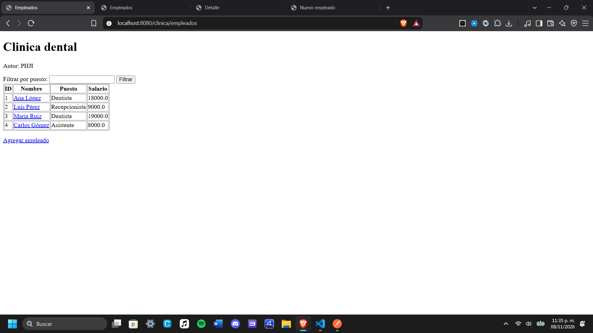
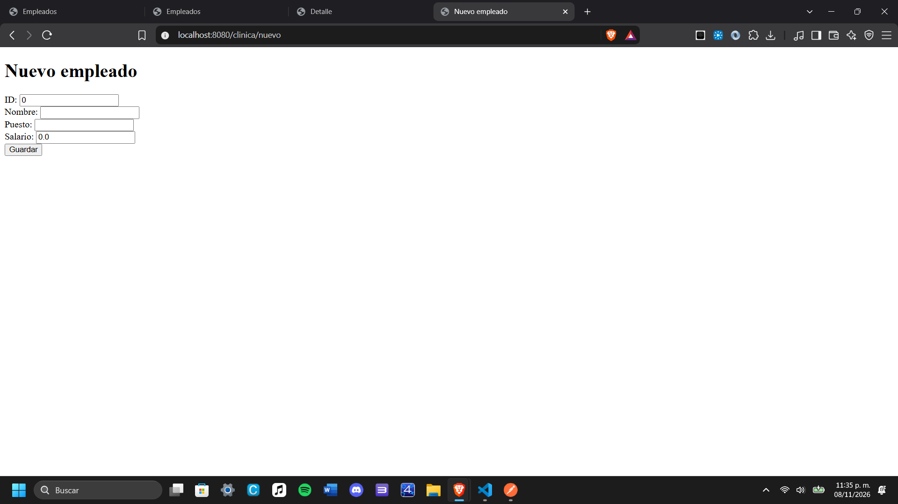
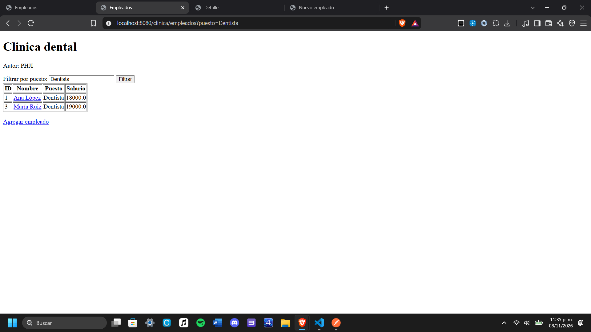
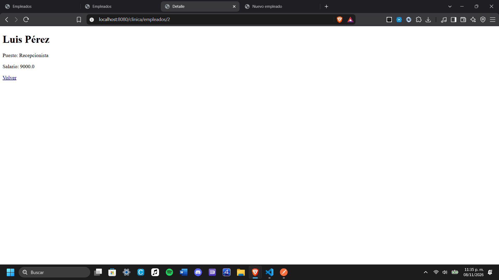
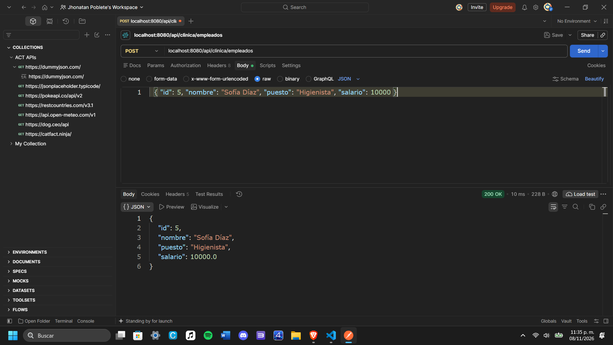

# Actividad 2 - Spring MVC con Thymeleaf

Proyecto de la clínica dental con vistas Thymeleaf, DTO, @RequestParam, @PathVariable, @ModelAttribute y @Value.

## 1. Listado (Model + th:each)
Ruta: `/clinica/empleados`

## 2. Formulario (@ModelAttribute)
Ruta: `/clinica/nuevo`

## 3. Filtro (@RequestParam)
Ruta: `/clinica/empleados?puesto=Dentista`

## 4. Detalle (@PathVariable)
Ruta: `/clinica/empleados/2`

## 5. POST probado en Postman (@RequestBody + DTO)
Ruta: `POST /api/clinica/empleados`

## Despliegue en el VPS
- Actividad 2: http://157.180.30.55:8083/clinica/empleados
- Actividad 1 (sigue corriendo en su puerto original): http://157.180.30.55:8081/proyecto
